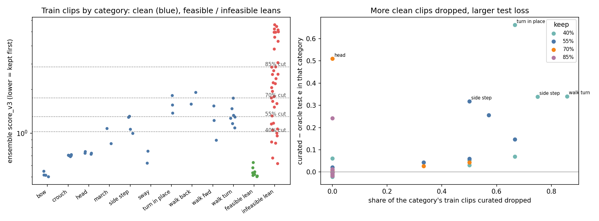

# Study cv7: why curation drops clean clips

Ranking: ensemble `score_v3` over 3 scoring policies, lower = kept first. 37 clean clips, 8 feasible leans, 37 infeasible leans.

## 1. Score overlap

- AUC, clean vs infeasible leans: **0.831** (1 = every infeasible lean scores worse than every clean clip).
- Clean clips scoring worse than the best-scoring infeasible lean: **33 of 37**.
- Clean clips scoring worse than the median infeasible lean: **0 of 37**: none.

| category | clean train clips | median score | worst score | worst rank (of 82) |
|---|---|---|---|---|
| bow | 4 | 0.51 | 0.55 | 10 |
| crouch | 6 | 0.70 | 0.71 | 21 |
| head | 4 | 0.73 | 0.75 | 25 |
| march | 2 | 0.96 | 1.08 | 37 |
| side_step | 4 | 1.17 | 1.31 | 46 |
| sway | 2 | 0.69 | 0.75 | 26 |
| turn_in_place | 3 | 1.56 | 1.82 | 60 |
| walk_back | 2 | 1.75 | 1.91 | 61 |
| walk_fwd | 3 | 1.22 | 1.54 | 52 |
| walk_turn | 7 | 1.29 | 1.74 | 57 |
| infeasible lean | 37 | 2.19 | 5.57 | 82 |

## 2. What curated drops

| keep | clean dropped | infeasible leans kept | clean dropped while ranked below a kept infeasible lean |
|---|---|---|---|
| 40% | 15 | 3 | 15 |
| 55% | 10 | 10 | 10 |
| 70% | 2 | 14 | 2 |
| 85% | 0 | 25 | 0 |

At 55%, each dropped clean clip and the infeasible leans kept ahead of it:

| dropped clean clip | score | rank | infeasible leans kept with a better score |
|---|---|---|---|
| `side_step__dx0_dy-0.015_dth0__normal` | 1.29 | 44 | 10 of 10 |
| `walk_turn__dx0.04_dy0_dth-0.15__gentle` | 1.29 | 45 | 10 of 10 |
| `side_step__dx0_dy0.015_dth0__normal` | 1.31 | 46 | 10 of 10 |
| `walk_turn__dx0.02_dy0_dth0.15__normal` | 1.33 | 48 | 10 of 10 |
| `walk_turn__dx0.02_dy0_dth0.15__gentle` | 1.47 | 50 | 10 of 10 |
| `walk_fwd__dx0.05_dy0_dth0__gentle` | 1.54 | 52 | 10 of 10 |
| `turn_in_place__dx0_dy0_dth0.15__normal` | 1.56 | 53 | 10 of 10 |
| `walk_turn__dx0.04_dy0_dth-0.15__normal` | 1.74 | 57 | 10 of 10 |
| `turn_in_place__dx0_dy0_dth0.30__gentle` | 1.82 | 60 | 10 of 10 |
| `walk_back__dx-0.03_dy0_dth0__gentle` | 1.91 | 61 | 10 of 10 |

The infeasible leans curated keeps at 55% (they fail the static hold test; the scoring policies' falls):

| lean | lean size (cm) | score | scorer falls (of 10 per scorer) |
|---|---|---|---|
| `lean__44__dx-0.027` | -2.7 | 0.62 | 0, 0, 0 |
| `lean__04__dx-0.029` | -2.9 | 0.67 | 0, 0, 0 |
| `lean__11__dx-0.033` | -3.3 | 0.85 | 0, 0, 0 |
| `lean__32__dx+0.062` | +6.2 | 0.87 | 0, 0, 0 |
| `lean__38__dx-0.035` | -3.5 | 0.96 | 0, 0, 0 |
| `lean__24__dx+0.066` | +6.6 | 1.00 | 0, 0, 0 |
| `lean__13__dx+0.068` | +6.8 | 1.05 | 0, 0, 0 |
| `lean__39__dx+0.070` | +7.0 | 1.07 | 0, 0, 0 |
| `lean__25__dx-0.041` | -4.1 | 1.16 | 0, 0, 0 |
| `lean__21__dx-0.042` | -4.2 | 1.17 | 0, 0, 0 |

## 3. Dropped clean clips against the test loss

Per (category, fraction): the share of the category's train clips curated dropped, and curated minus oracle mean test e in that category (3 seeds). Oracle keeps every clean clip at 55% and above and 27 of 37 at 40%.

Spearman ρ = **0.72** (p = 2.11e-07, n = 40 category × fraction points; points share policies, so p is optimistic).

| fraction | category | share dropped | curated − oracle e |
|---|---|---|---|
| 40% | turn_in_place | 0.67 | +0.663 |
| 70% | head | 0.00 | +0.510 |
| 40% | walk_turn | 0.86 | +0.341 |
| 40% | side_step | 0.75 | +0.339 |
| 55% | side_step | 0.50 | +0.317 |
| 55% | walk_turn | 0.57 | +0.256 |
| 85% | head | 0.00 | +0.242 |
| 55% | turn_in_place | 0.67 | +0.147 |
| 40% | walk_fwd | 0.67 | +0.069 |
| 40% | head | 0.00 | +0.061 |
| 55% | walk_back | 0.50 | +0.059 |
| 40% | walk_back | 0.50 | +0.053 |

(the 12 largest losses)

