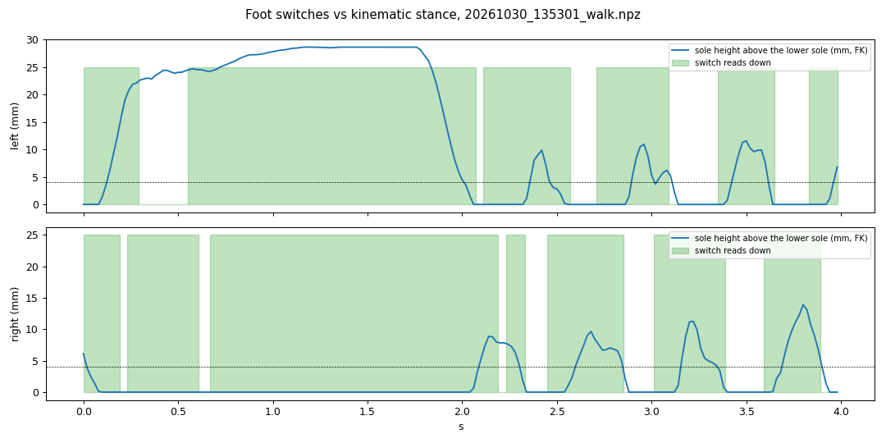

# Foot switches vs kinematic stance (S1.3)

**Tool:** `curation/analysis/foot_switch_check.py` on 15 robot walk logs (10,007 steps while moving; 2026-10-30 and
2026-11-02).

**Method:**
- There is no ground truth in the logs, so the reference is kinematic.
- With the recorded joint angles, forward kinematics gives each sole's height in the trunk frame.
- A foot within 4 mm of the lower sole counts as down.

**Agreement with the kinematic stance call:**

| Hypothesis | Left | Right |
|---|---|---|
| Switches as wired | 46% | 46% |
| Inverted | 54% | 54% |
| **Left/right swapped** | **73%** | **75%** |
| Swapped and inverted | 27% | 25% |

**Further observations:**
- As wired, when a foot is kinematically lifted its switch still reads "down" 95% of the time.
- In the steady part of a walk, each switch reads "down" while **its own** foot swings (plot below).

**Likely conclusion:** the two switches are wired to the opposite feet.

**Caveats:**
- The kinematic reference ignores body tilt. Adding tilt from the IMU made the result lopsided (left foot "down" 19%
  of the time, right 88%), which suggests the IMU's 17.5° offset is not purely a mounting angle.
- The trunk-frame version is the more trustworthy of the two, but this is evidence, not proof.
- **Confirm with robot test R1** (`docs/ROBOT_TESTS.md`, 5 minutes).

**Why it matters:**
- The deployed walker takes foot contacts as input, so swapped switches feed it mirrored contact data.
- For this project, the contact signal goes into the tracking policy's observation, so it must be right, or left out.

